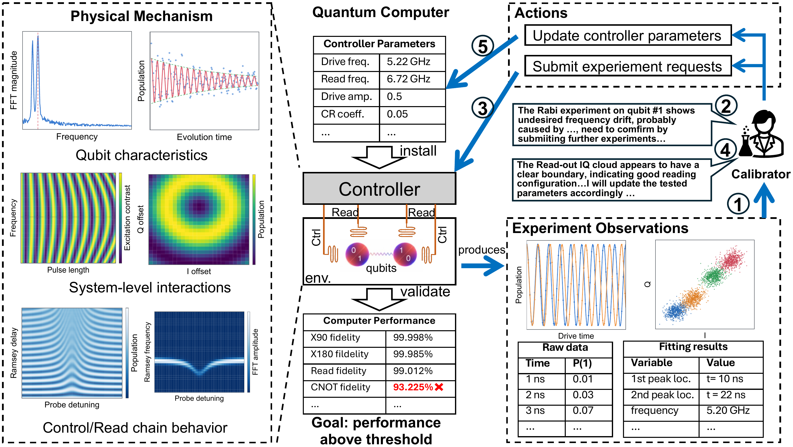
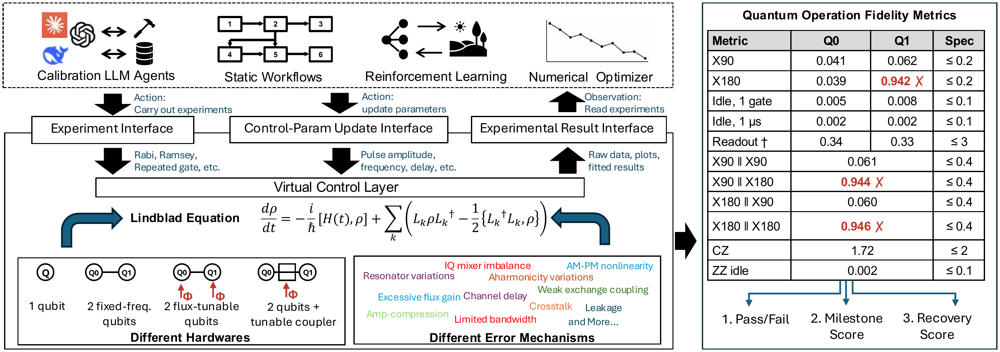

# QCalGym

QCalGym benchmarks the full calibration loop for superconducting quantum processors: observe a performance shortfall, design diagnostic experiments, interpret the results, and update control parameters until every operation meets its target. It provides a reproducible virtual laboratory for evaluating standalone LLMs, agent systems, fixed workflows, numerical optimizers, and reinforcement learning policies.

[](figs/Presentation1.pdf)

The Docker environment combines **42 experiment types, 18 physical mechanisms, four device configurations, and 27 hardware scenes**. Calibrators can interact with the virtual quantum processors with the same action and observation interface (HTTP): run experiments, read raw data, fitted results and plots, and update controls within a resource budget. Each run records its experiments and final performance for evaluation.

[](figs/QCalGym_Env.pdf)

QCalGym contains two tracks:

- **Troubleshoot:** given the initial performance and hardware description, diagnose the fault and repair the device through experiments.
- **Tune:** given the faulty control parameters and their search bounds, find working values while changing only those parameters.

| Track | Tasks | Scenes | Difficulty |
| --- | ---: | ---: | --- |
| Troubleshoot | 108 | 27 | 1, 4 or 7 faulty parameters, or cold start |
| Tune | 30 | 10 | 1, 3 or 5 named faulty parameters |

## Leaderboards

Success rates show **pass@1 (pass@3)**; Milestone measures progress through observation, diagnosis and correction; Recovery measures how much of the initial performance gap is closed.

### Troubleshoot

| Approach | Model / Method | Easy | Medium | Hard | Cold-start | Average | Milestone | Recovery |
| --- | --- | ---: | ---: | ---: | ---: | ---: | ---: | ---: |
| Blueprint | GPT-6.1-Sol | 96.3% (100.0%) | 77.8% (88.9%) | 74.1% (88.9%) | 29.6% (44.4%) | **69.4% (80.6%)** | **0.92** | **0.92** |
| Blueprint | Claude-Sonnet-5.5 | 66.7% (77.8%) | 33.3% (55.6%) | 7.4% (14.8%) | 2.5% (7.4%) | 27.5% (38.9%) | 0.63 | 0.59 |
| Blueprint | Gemini-3.8-Flash | 53.1% (66.7%) | 29.6% (37.0%) | 14.8% (29.6%) | 1.2% (3.7%) | 24.7% (34.3%) | 0.63 | 0.54 |
| Blueprint | Nemotron-Ising | 0.0% (0.0%) | 0.0% (0.0%) | 0.0% (0.0%) | 0.0% (0.0%) | 0.0% (0.0%) | 0.00 | 0.00 |
| Blueprint | Nemotron-Ultra | 7.4% (18.5%) | 4.9% (7.4%) | 0.0% (0.0%) | 0.0% (0.0%) | 3.1% (6.5%) | 0.43 | 0.08 |
| Blueprint | DeepSeek-V4.1-Flash | 49.4% (66.7%) | 21.0% (40.7%) | 4.9% (11.1%) | 0.0% (0.0%) | 18.8% (29.6%) | 0.52 | 0.44 |
| K-Agent | DeepSeek-V4.1-Flash | 7.4% (7.4%) | 0.0% (0.0%) | 0.0% (0.0%) | 0.0% (0.0%) | 1.9% (1.9%) | 0.06 | 0.06 |
| Vibe-Cali | DeepSeek-V4.1-Flash | 35.8% (44.4%) | 16.0% (22.2%) | 3.7% (3.7%) | 0.0% (0.0%) | 13.9% (17.6%) | 0.47 | 0.45 |
| Static workflow | QUAlibrate | 4.4% (4.4%) | 4.4% (4.4%) | 4.4% (4.4%) | 4.4% (4.4%) | 4.4% (4.4%) | 0.58 | 0.55 |
| Static workflow | QubiC | 25.9% (25.9%) | 25.9% (25.9%) | 25.9% (25.9%) | 25.9% (25.9%) | 25.9% (25.9%) | 0.65 | 0.66 |
| Static workflow | Combined | 25.9% (25.9%) | 25.9% (25.9%) | 25.9% (25.9%) | 25.9% (25.9%) | 25.9% (25.9%) | 0.63 | 0.58 |

Ising supplies both reasoning and vision. Static workflows start every task cold; Combined uses QUAlibrate and QubiC.

### Tune

| Approach | Model / Method | Easy | Medium | Hard | Average | Recovery |
| --- | --- | ---: | ---: | ---: | ---: | ---: |
| Blueprint | DeepSeek-V4.1-Flash | 56.7% (80.0%) | 46.7% (60.0%) | 20.0% (30.0%) | **41.1% (56.7%)** | **0.72** |
| Numerical optimization | CMA-ES | 50.0% (70.0%) | 20.0% (40.0%) | 3.3% (10.0%) | 24.4% (40.0%) | 0.40 |
| Numerical optimization | SPSA | 26.7% (40.0%) | 10.0% (10.0%) | 0.0% (0.0%) | 12.2% (16.7%) | 0.21 |
| Numerical optimization | Nelder-Mead | 33.3% (50.0%) | 10.0% (10.0%) | 0.0% (0.0%) | 14.4% (20.0%) | 0.22 |
| RL | SAC | 50.0% (70.0%) | 13.3% (20.0%) | 3.3% (10.0%) | 22.2% (33.3%) | 0.49 |

## Quick start 

QCalGym provides tasks and environments for any calibrators. Here we provide an example as a quick start: [NVIDIA's Quantum Calibration Agent Blueprint](https://github.com/NVIDIA/Quantum-Calibration-Agent-Blueprint) (NVIDIA, 2026; Apache-2.0). 

Install **Docker with Compose** and **Python 3.11+**. Run the following commands from this directory.

### Single task

At the top of [`setup_blueprint.py`](setup_blueprint.py), set `base_url`, `model`, and `api_key` separately in `REASONING_MODEL` and `VISION_MODEL`. Both routes use OpenAI-compatible Chat Completions APIs; the reasoning model plans and calls tools, and the vision model reads plots. Alternatively, leave the keys empty and set `QCALGYM_REASONING_API_KEY` and `QCALGYM_VISION_API_KEY` in your environment.

Start the benchmark:

```sh
docker compose build
docker compose up
```

This starts `V4-Scene-001-EASY-01` with seed `0` on port `8000`. Wait for the connection information, then run in another terminal:

```sh
python setup_blueprint.py --connection runs/RUN_DIRECTORY/connection.json --run
```
(Replace `RUN_DIRECTORY` with the directory printed by the benchmark)

After the agent submits, the benchmark saves acceptance metrics in `final.json`, pass/fail and Recovery in `result.json`, final controls in `calibration.json`, and experiment data and plots under `host/`, all inside the run directory.

### Full benchmark

Use the following commands to run the full benchmark:

```sh
docker compose run --rm benchmark list --track troubleshoot
docker compose run --rm benchmark list --track tune
```


```sh
docker compose run --rm --service-ports benchmark serve --task V4-Scene-001-EASY-01 --seed 0 --output /runs/blueprint/troubleshoot
```

```sh
python setup_blueprint.py --connection runs/blueprint/troubleshoot/RUN_DIRECTORY/connection.json --output blueprint/RUN_DIRECTORY --run
```

Use the new `RUN_DIRECTORY` for each attempt so agent workspaces stay independent. For Tune, select its task IDs and replace `troubleshoot` with `tune` in the output paths. Keep results for each method and track in separate directories, then aggregate:

```sh
docker compose run --rm benchmark report /runs/blueprint/troubleshoot --k 1
docker compose run --rm benchmark report /runs/blueprint/troubleshoot --k 3
```

## Connect your own agent, LLM, or program

Any calibrator can use the same HTTP interface. Start a task as above, configure your models in your own program, and use [`client.py`](client.py) to connect:

```python
import json
from pathlib import Path
from client import Client, TOOLS

client = Client(json.loads(Path("runs/RUN_DIRECTORY/connection.json").read_text()))
state = client.call("status")
experiments = client.call("catalog")
controls = client.call("controls")
```

Pass `TOOLS` to a tool-calling model and forward each call with `client.call(name, arguments)`. Use `run_experiment` to acquire measurements, `update_calibration` to apply corrections, `check_raw_data` or `get_data` to inspect stored data, and `submit` to finish. Download figure and data artifacts with `client.download(artifact)`.

[Observation and Action Space](Observation_Action_Space.md) contains all eight API signatures, experiment parameters, control fields, and observation formats. Export tool schemas with `python client.py > tools.json`; query `catalog` and `controls` for the connected task's exact capabilities. Other languages can call `POST /call` with `{"action":"status","params":{},"request_id":"request-1"}` and the connection file's `Authorization: Bearer TOKEN`.

## Customize scenes, tasks, and benchmarks

- **Scenes and physics:** copy a JSON file in [`scenes/`](scenes/), then edit its device, `initial_controls`, and `reference_controls`. Add new mechanisms through `DeviceConfig` in [`backend/device.py`](backend/device.py) and the relevant dynamics modules in `backend/`.
- **Tasks and scoring:** add a record to [`tasks/troubleshoot.json`](tasks/troubleshoot.json) or [`tasks/tune.json`](tasks/tune.json). Each record specifies `id`, `scene`, `tier`, `cold`, and fixed `changes`. Warm tasks perturb reference controls; cold tasks use initial controls. Set acceptance thresholds in [`tasks/thresholds.json`](tasks/thresholds.json) and scoring in [`benchmark/scoring.py`](benchmark/scoring.py).
- **Actions and observations:** implement experiments under [`backend/experiments/`](backend/experiments/), register them through [`backend/benchmark/catalog.py`](backend/benchmark/catalog.py) and [`backend/probes.py`](backend/probes.py); flux experiments use [`backend/flux_benchmark_session.py`](backend/flux_benchmark_session.py). Control schemas, action dispatch and data access live in [`backend/benchmark/`](backend/benchmark/). Update `client.py` when adding a public API.

Pass `--experiments`, `--shots`, or `--seconds` to `serve` for custom budgets. Rebuild the Docker image after changing source files or task definitions. See the [illustrated reference calibrations](references/index.html) for solutions to all 27 scenes.

## Directory structure

```text
.
├── backend/                     # Device physics, experiments, and HTTP interface
├── benchmark/                   # Task server, track rules, and scoring
├── scenes/                      # 27 hardware scenes and reference controls
├── tasks/                       # Task definitions and acceptance thresholds
├── references/                  # Illustrated reference calibrations
├── figs/                        # README figures: PDF originals and PNG previews
├── client.py                    # HTTP client and eight tool schemas
├── setup_blueprint.py           # Model settings and Blueprint setup
├── Observation_Action_Space.md  # Complete interface reference
├── Dockerfile                   # Benchmark image
├── compose.yaml                 # Local task launch
├── requirements.txt             # Environment dependencies
├── blueprint/                   # Generated agent workspaces
└── runs/                        # Generated connections, traces, and results
```
